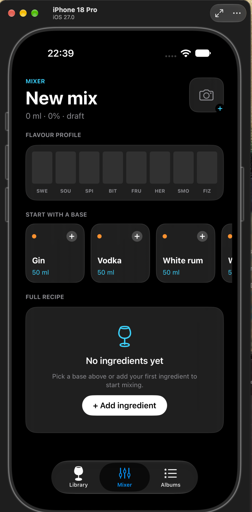
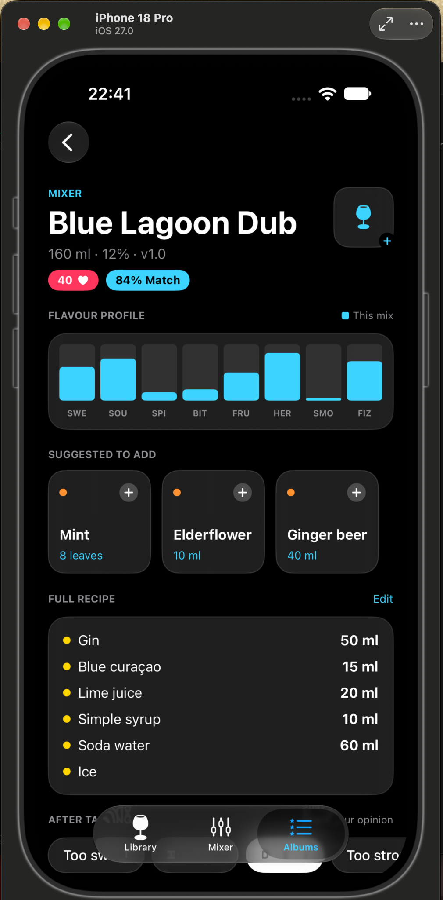
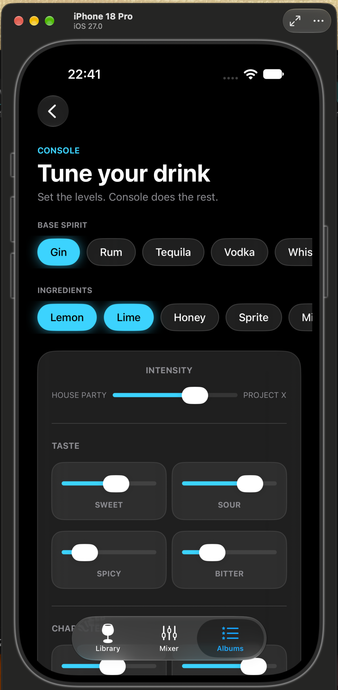
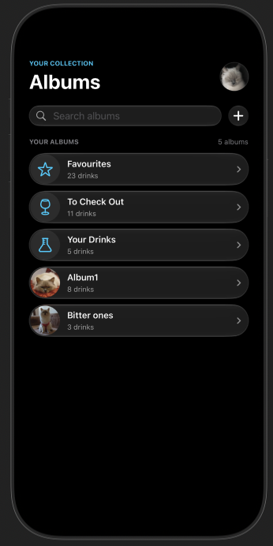
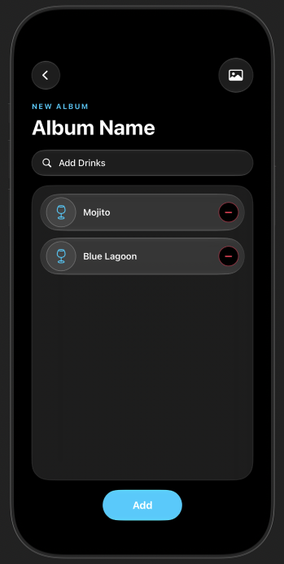
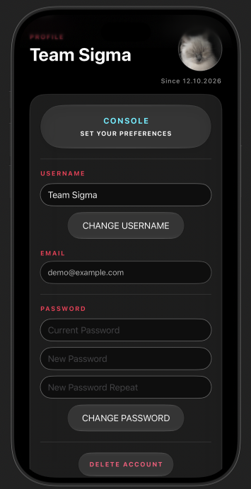

# Drink DJ
Application for drink creation and drink version control system. It allows user to create, review and share their drinks with the community.

## Development
Project runs on devices with IOS 27 systems (Preferably IPhone 18 Pro).

## Specification
Specification for this project is located inside `./spec` folder.

## Database
PostgreSQL scripts of the database are located inside `./Database` folder. See `Database/README.md`.

## Views

### Mixer View

### Preferences Console View

### Albums List View

### New Album View

### Profile View

