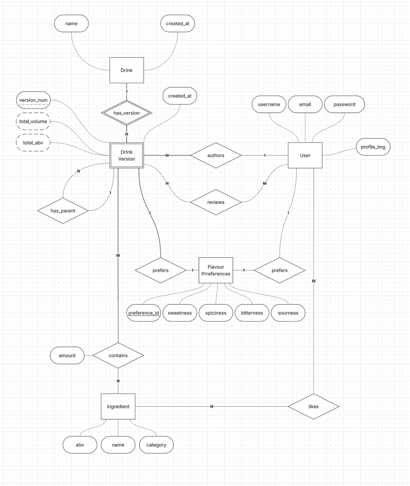

# Conceptual Modeling
This part of the specification describes the conceptual data model of the Drink DJ database.
It was done using Entity Relationship Diagram.

*Link to diagram: [Lucidchart](https://lucid.app/lucidchart/41749a4e-7fe5-48b8-8c8b-364a38823fc2/view).*

*Link to PDF version: [erd.pdf](diagram/erd.pdf).*